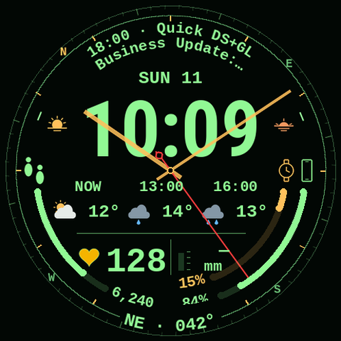
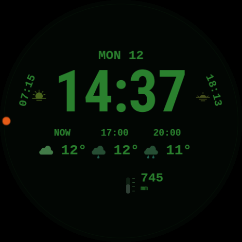

# Pip-Boy watch face

A green instrument-panel watch face for Wear OS, built with Watch Face Format 3. Large digital time sits inside a compass rim, with an analog hand, weather, steps, heart rate, watch and phone battery, pressure, sunrise and sunset. A calendar event follows the upper arc.

**Status:** experimental source project, version 0.2.0. Tested on a Galaxy Watch SM-L715F running Wear OS 7 (Android 17), 498 × 498 display. It has not been packaged for the Play Store. The compass animation and battery impact still need longer real-world testing.

 

*Left: generated preview with sample values, not a watch screenshot. Right: screenshot of ambient mode on the test watch.*

[Українською](README.uk.md) · [Install on a watch](docs/install.md) · [Source and limitations](docs/data-sources.md)

## What you need

- A compatible Wear OS watch with Android 15 or newer (SDK 35+). The tested device is listed above; other models are unverified.
- A computer with Android Debug Bridge (ADB) and wireless access to the watch for sideloading.
- Two APKs built from this repository: the watch face and its companion. No phone application is required.

The companion supplies compass, pressure, sunrise and sunset complications. Other values come from the watch or complication providers already installed on your devices. Phone battery needs a compatible **RANGED_VALUE** phone-battery provider; the face does not include one.

## Install and set up

Follow the [step-by-step installation guide](docs/install.md). Build both APKs with `bash scripts/build.sh`, pair ADB with the watch, install the companion first, then the face, and choose **Pip-Boy** in the watch-face picker. In the face editor, assign the calendar, phone battery, compass, barometer, sunrise and sunset sources. Open **Pip-Boy Compass** once to enable its sensor service. For solar times, grant approximate and background location to the companion and open its environment screen to fetch the watch's location.

The source has no prebuilt release APK or store listing. APKs made by `scripts/build.sh` are debug builds signed on your machine. Do not assume that an APK from another builder can update one you built locally.

## How the face behaves

The compass uses the watch's rotation sensor and may disappear when the display sleeps, locks, or the sensor reading becomes stale. Ambient mode keeps time, weather, pressure and solar times while hiding the active compass and other busy elements. Weather and calendar availability depend on the watch's system providers and their permissions. Sunrise and sunset use an approximate watch location; pressure uses the watch's pressure sensor. Missing data appears as missing data rather than a made-up reading.

The project makes no network request of its own. Location and pressure history stay on the watch in the companion's local storage; the face itself receives data through Wear OS complications. Android permissions used by the companion are explained in the [installation guide](docs/install.md#permissions-and-privacy).

## For developers

The face is generated by `scripts/generate.py` into `watchface/`; the companion lives in `compass/`. `scripts/render.py` makes illustrative previews with sample values. `scripts/build.sh` runs the generator, Python tests, Android unit tests, lint and APK assembly. You need JDK 17+, Android SDK platform 36 and build-tools 35.0.0, Python 3 with Pillow, and Node.js for the preview/test tools. Set `JAVA_HOME` and `ANDROID_HOME` if they are outside the script's local default toolchain path.

```bash
python3 -m pip install Pillow
bash scripts/build.sh
```

Output: `artifacts/PipBoy-0.2.0-debug.apk`, `artifacts/PipBoy-Compass-0.2.0-debug.apk`, and `artifacts/SHA256SUMS`. The repository tracks source and documentation; `artifacts/` stays local. The original design handoff is in `pip-boy-watchface-handoff/`. Third-party font notices are in `licenses/`.
