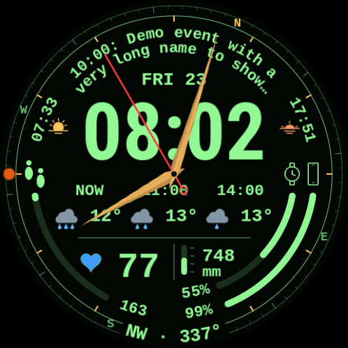
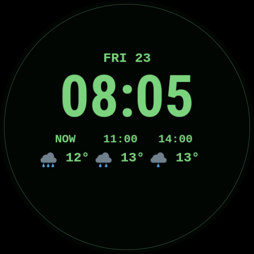

# Циферблат Pip-Boy

Циферблат для Wear OS у стилі Pip-Boy, натхненний Fallout. Основний час — великий цифровий, а поверх нього працюють годинна, хвилинна й секундна стрілки. Поруч видно погоду, дату, наступну подію календаря, пульс, кроки, заряд годинника й телефона, компас, барометр і час сходу та заходу сонця.

**Стан:** експериментальний проєкт із вихідним кодом, версія 0.3.0. Попередні debug-збірки перевірено на Samsung Galaxy Watch Ultra2 (2026; модель SM-L715F) з Wear OS 7 (Android 17), екран 498 × 498. Публікації в Play Store немає. Робота release 0.3.0, міграція підпису та збереження конфігурації ще потребують перевірки на годиннику. Витрату батареї в контрольованому порівнянні не вимірювали.

 

*Незмінені знімки з годинника від 23 жовтня 2026 року: поточний активний режим ліворуч, природний AOD праворуч.*

[English](README.md) · [Установлення на годинник](docs/install.uk.md) · [Джерела даних та обмеження](docs/data-sources.uk.md) · [Усунення проблем](docs/troubleshooting.uk.md)

## Що потрібно

- Годинник Wear OS з Android 15 або новішим (SDK 35+). Підтверджено роботу лише на пристрої, зазначеному вище.
- Комп’ютер з Android Debug Bridge (ADB) і мережевим доступом до годинника для встановлення APK.
- Два APK з цього репозиторію: циферблат і застосунок-компаньйон. Сам циферблат не потребує застосунку на телефоні.

Компаньйон надає ускладнення компаса, тиску, сходу й заходу сонця. Решту даних дають система годинника та встановлені провайдери. Для заряду телефона встанови [Phone Battery Complication](https://play.google.com/store/apps/details?id=com.weartools.phonebattcomp&hl=en) на телефон і годинник. Це сторонній провайдер, який не входить у комплект циферблата; якщо він уже встановлений, циферблат вибирає його джерело **RANGED_VALUE** за замовчуванням.

## Установлення

Виконай [покрокову інструкцію](docs/install.uk.md): збери обидва APK через `bash scripts/build-release.sh`, спаруй ADB з годинником, установи спочатку компаньйон, потім циферблат і вибери **Pip-Boy** у списку циферблатів. Джерела календаря, заряду телефона, компаса, тиску, сходу й заходу сонця вже задані в циферблаті; за наявності провайдерів їх не потрібно вибирати вручну. Один раз відкрий **Pip-Boy Compass**, щоб запустити датчик. Для сонячних подій надай компаньйону приблизне місце та дозвіл на фонове місце, потім відкрий екран із часом сходу й заходу для отримання координат годинника.

Основний варіант — два підписані **release APK 0.3.0** з [GitHub Releases](https://github.com/and1gum/pip-boy-watchface/releases). Компаньйон використовує оптимізацію коду й ресурсів R8; економію батареї ще не виміряно. Debug-збірка залишається доступною через `bash scripts/build.sh`.

Release підписано окремим постійним ключем із підтвердженим переходом від початкового debug-ключа проєкту. [Скрипт установлення](docs/install.uk.md#4-установи-й-вибери-циферблат) перевіряє підписи обох установлених APK перед оновленням без видалення. Механізм розрахований на збереження наявної інсталяції разом із налаштуваннями циферблата, якими керує система; це ще потрібно перевірити на годиннику. Debug-збірка з іншим ключем несумісна. [Підпис і міграція](docs/release-signing.uk.md).

## Як працює циферблат

Компас читає датчик обертання годинника. Він може зникати, коли дисплей згасає, блокується або дані датчика застарівають. У режимі AOD залишаються лише дата, цифровий час і погода. Тиск, схід і захід сонця видно тільки на активному екрані. Доступність погоди й календаря залежить від системних провайдерів та їхніх дозволів. Частоту отримання погоди визначає системна служба годинника; WFF не дозволяє циферблату задати годинний інтервал. Для сходу й заходу використовується приблизне місце годинника, для тиску — його датчик. За відсутності значення циферблат не підставляє вигадане число.

Колір серця показує діапазон пульсу. За замовчуванням межі й кольори задані в коді:

| Пульс, уд/хв | Колір |
| --- | --- |
| 1–98 | Синій |
| 99–109 | Зелений |
| 110–131 | Жовтий |
| 132–164 | Помаранчевий |
| Від 165 | Червоний |

У редакторі циферблата можна вручну змінити чотири межі між діапазонами; вони мають іти за зростанням. Кольори залишаються фіксованими. Це локальна індикація циферблата, а не персональні зони Samsung Health. Якщо пульс недоступний, замість числа з’являється риска, а серце має стандартний зелений колір без визначення зони.

Проєкт сам не надсилає дані в мережу. Координати й історія тиску залишаються в локальному сховищі компаньйона; циферблат отримує значення через ускладнення Wear OS. Дозволи Android пояснені в [інструкції](docs/install.uk.md#дозволи-й-приватність).

## Натискання на циферблаті

| Ділянка | Що відкриває |
| --- | --- |
| Погода | Samsung Weather |
| Дуга календаря | Подію системного календаря |
| Значок або сектор кроків | Кроки в Samsung Health |
| Значок або сектор заряду годинника чи телефона | Стан батареї годинника |
| Нижнє число кроків чи заряду або напрямок компаса | Samsung Compass |
| Число пульсу | Екран пульсу |
| Схід або захід сонця | Екран місцезнаходження компаньйона |

Переходи до застосунків Samsung потребують їх встановлення.

## Допомога й розробка

- [Усунення проблем](docs/troubleshooting.uk.md): відсутні дані, пробудження компаса, оновлення та ADB.
- [Необов’язкова діагностика](docs/companion-diagnostics.uk.md): запис та експорт проблеми з компасом.
- [Довідка для розробника (англійською)](docs/development.md): збірка, структура коду та робота компаньйона.

Ліцензійні повідомлення сторонніх шрифтів і бібліотек — у [licenses/](licenses/).
