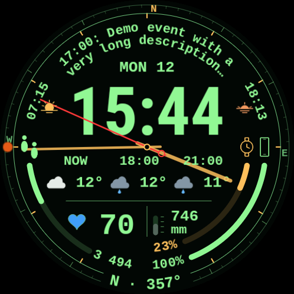

# Циферблат Pip-Boy

Циферблат для Wear OS у стилі Pip-Boy, натхненний Fallout. Основний час — великий цифровий, а поверх нього працюють годинна, хвилинна й секундна стрілки. Поруч видно погоду, дату, наступну подію календаря, пульс, кроки, заряд годинника й телефона, компас, барометр і час сходу та заходу сонця.

**Стан:** експериментальний проєкт із вихідним кодом, версія 0.2.0. Перевірено на Samsung Galaxy Watch Ultra2 (2026; модель SM-L715F) з Wear OS 7 (Android 17), екран 498 × 498. Публікації в Play Store немає. Плавність компаса й вплив на батарею ще потребують тривалого тестування.

 

*Обидва зображення — незмінені скриншоти з тестового годинника: активний режим ліворуч, AOD праворуч. [Новий порядок стрілок на годиннику](docs/images/hand-order-on-watch.png) знято після виправлення; погода в цьому кадрі тимчасово не завантажилася після оновлення APK.*

[English](README.md) · [Установлення на годинник](docs/install.uk.md) · [Джерела даних та обмеження (англійською)](docs/data-sources.md)

## Що потрібно

- Годинник Wear OS з Android 15 або новішим (SDK 35+). Підтверджено роботу лише на пристрої, зазначеному вище.
- Комп’ютер з Android Debug Bridge (ADB) і мережевим доступом до годинника для встановлення APK.
- Два APK з цього репозиторію: циферблат і застосунок-компаньйон. Сам циферблат не потребує застосунку на телефоні.

Компаньйон надає ускладнення компаса, тиску, сходу й заходу сонця. Решту даних дають система годинника та встановлені провайдери. Для заряду телефона встанови [Phone Battery Complication](https://play.google.com/store/apps/details?id=com.weartools.phonebattcomp&hl=en) на телефон і годинник. Це сторонній провайдер, який не входить у комплект циферблата; якщо він уже встановлений, циферблат вибирає його джерело **RANGED_VALUE** за замовчуванням.

## Установлення

Виконай [покрокову інструкцію](docs/install.uk.md): збери обидва APK через `bash scripts/build.sh`, спаруй ADB з годинником, установи спочатку компаньйон, потім циферблат і вибери **Pip-Boy** у списку циферблатів. Джерела календаря, заряду телефона, компаса, тиску, сходу й заходу сонця вже задані в циферблаті; за наявності провайдерів їх не потрібно вибирати вручну. Один раз відкрий **Pip-Boy Compass**, щоб запустити датчик. Для сонячних подій надай компаньйону приблизне місце та дозвіл на фонове місце, потім відкрий екран із часом сходу й заходу для отримання координат годинника.

У репозиторії немає готового release-APK або сторінки магазину. `scripts/build.sh` створює debug-APK з підписом твоєї машини. APK, зібраний іншим розробником, може не встановитися поверх твоєї збірки.

## Як працює циферблат

Компас читає датчик обертання годинника. Він може зникати, коли дисплей згасає, блокується або дані датчика застарівають. У режимі AOD залишаються час, погода, тиск і час сонячних подій. Доступність погоди й календаря залежить від системних провайдерів та їхніх дозволів. Для сходу й заходу використовується приблизне місце годинника, для тиску — його датчик. За відсутності значення циферблат не підставляє вигадане число.

Колір серця показує діапазон пульсу. За замовчуванням межі й кольори задані в коді:

| Пульс, уд/хв | Колір |
| --- | --- |
| 1–98 | Синій |
| 99–109 | Зелений |
| 110–131 | Жовтий |
| 132–164 | Помаранчевий |
| Від 165 | Червоний |

У редакторі циферблата можна вручну змінити чотири межі між діапазонами; вони мають іти за зростанням. Кольори залишаються фіксованими. Це локальна індикація циферблата, а не персональні зони Samsung Health. Якщо пульс недоступний, замість числа з’являється риска, а серце має стандартний зелений колір без визначення зони.

Проєкт сам не надсилає дані в мережу. Координати й історія тиску залишаються в локальному сховищі компаньйона; циферблат отримує значення через ускладнення Wear OS. Дозволи Android пояснені в [інструкції](docs/install.uk.md#дозволи-й-приватність).

## Для розробників

`scripts/generate.py` створює WFF-файли в `watchface/`; код компаньйона лежить у `compass/`. `scripts/render.py` створює прев’ю з тестовими значеннями. `scripts/build.sh` запускає генерацію, Python-тести, Android unit-тести, lint і складання APK. Потрібні JDK 17+, Android SDK platform 36 та build-tools 35.0.0, Python 3 з Pillow і Node.js для прев’ю/тестових інструментів. Якщо інструменти лежать поза локальним типовим шляхом скрипта, задай `JAVA_HOME` та `ANDROID_HOME`.

```bash
python3 -m pip install Pillow
bash scripts/build.sh
```

Після збірки APK будуть у `artifacts/PipBoy-0.2.0-debug.apk` та `artifacts/PipBoy-Compass-0.2.0-debug.apk`; контрольні суми — в `artifacts/SHA256SUMS`. Ліцензії сторонніх шрифтів — у `licenses/`.
